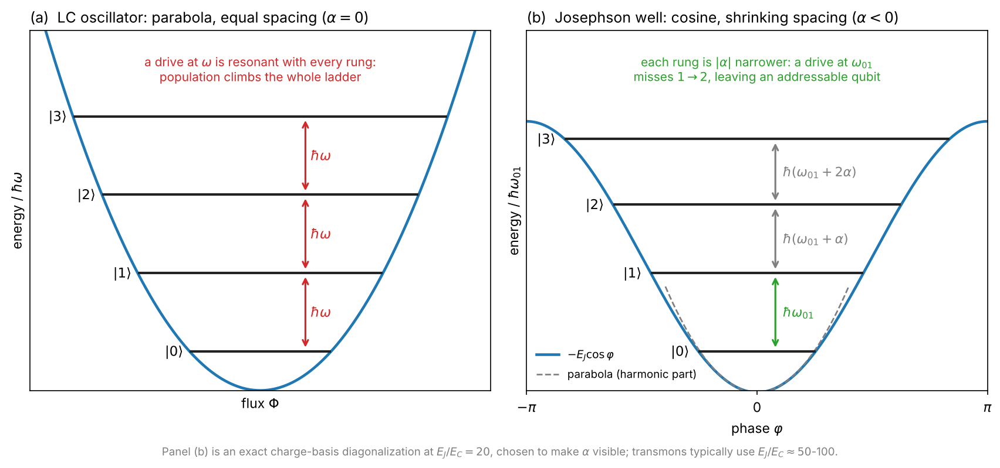
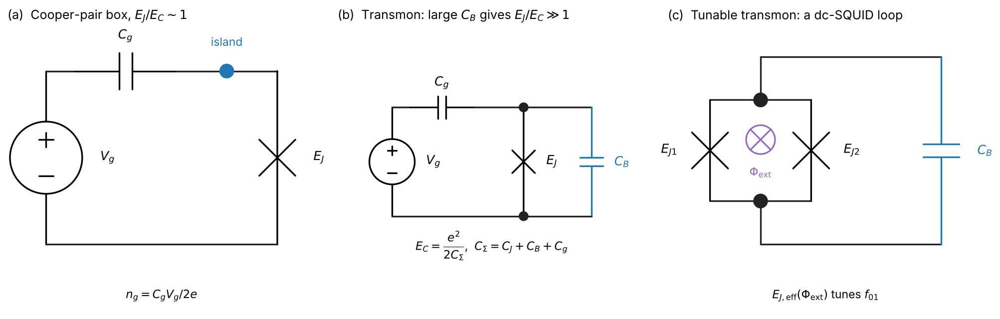
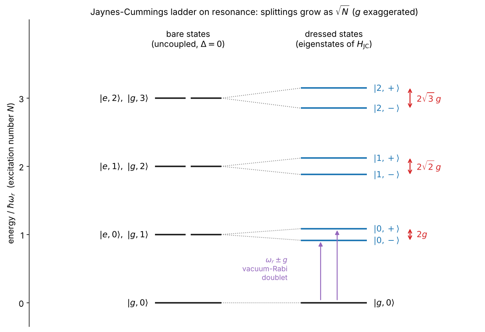
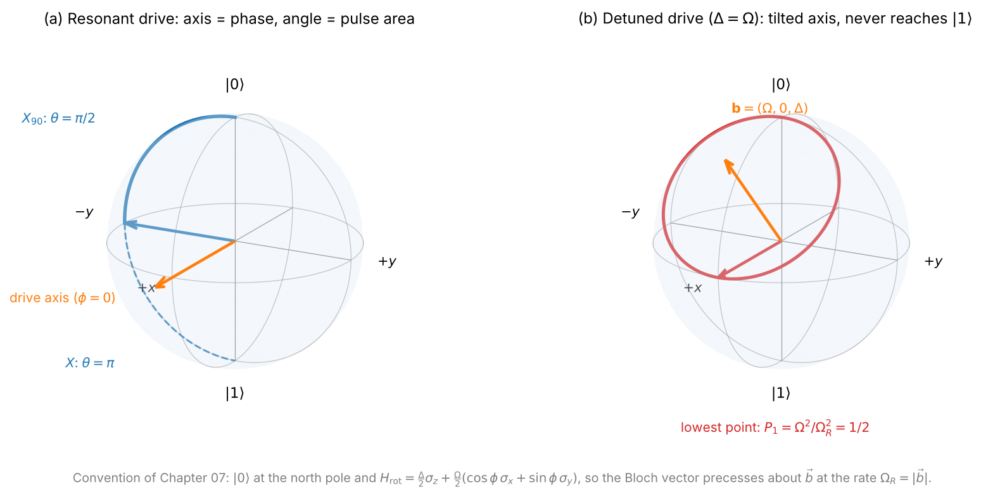
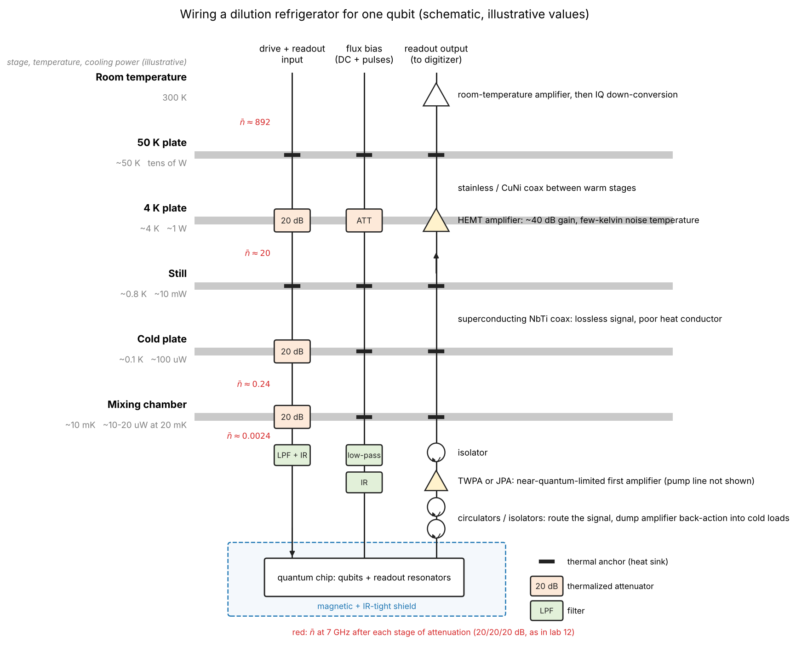
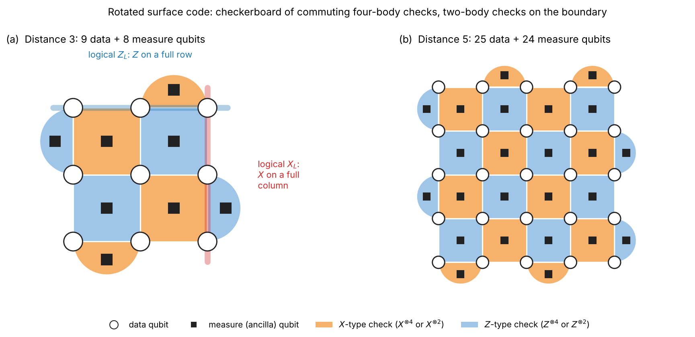

# superconducting-qubits-journey

*A from-scratch, beginner-friendly tutorial on superconducting qubits, plus the papers I'd hand a newcomer.*

---

## 👋 Hey there

I'm a PhD student working on superconducting qubits, and this repo is my attempt to write the introduction I wish I'd had when I started. It's a tutorial built **from scratch**, assuming nothing beyond undergraduate physics and a little linear algebra, for anyone who wants to pick up the field and actually understand *why* the hardware looks the way it does.

I wrote every explanation in my own words, teaching standard, publicly known physics. Where it helps, I point you to the canonical reviews and textbooks so you can go deeper. My goal is simple: take you from "what is a qubit?" all the way to a first look at quantum error correction, one chapter at a time.

If you find it useful, a ⭐ genuinely makes my day, and corrections are always welcome.

---

## 📖 The tutorial

Start with the index, then work through the chapters in order. Each one builds on the last.

- 📑 [**Tutorial index**](tutorial/README.md)
- 🧭 [**Guided learning path, exercises and answers**](tutorial/learning-path.md)
- 🔎 [**Notation and units**](tutorial/00-notation.md) · [**Map to Krantz et al.**](tutorial/paper-map.md)

| # | Chapter |
|---|---------|
| 01 | [Introduction: Why Superconducting Qubits](tutorial/01-introduction.md) |
| 02 | [The Quantum LC Oscillator](tutorial/02-quantum-lc-oscillator.md) |
| 03 | [The Josephson Junction & Anharmonicity](tutorial/03-josephson-junction.md) |
| 04 | [The Transmon Qubit](tutorial/04-transmon.md) |
| 05 | [Circuit QED: Qubits + Resonators](tutorial/05-circuit-qed.md) |
| 06 | [Dispersive Readout](tutorial/06-readout.md) |
| 07 | [Single-Qubit Gates & Control](tutorial/07-single-qubit-gates.md) |
| 08 | [Two-Qubit Gates](tutorial/08-two-qubit-gates.md) |
| 09 | [Coherence, Noise & Decoherence](tutorial/09-coherence-noise.md) |
| 10 | [The Cryogenic & Microwave Chain](tutorial/10-measurement-chain.md) |
| 11 | [Calibration & Benchmarking](tutorial/11-benchmarking.md) |
| 12 | [A First Look at Quantum Error Correction](tutorial/12-error-correction.md) |

### A look inside

Every chapter mixes derivations with pictures: 19 schematic diagrams (circuits, level ladders, Bloch spheres, pulse sequences, wiring, code layouts) and 22 plots computed from the same physics and parameters as the worked examples. All of them are original and regenerate from two scripts in [`tutorial/figures/`](tutorial/figures/).

<table>
<tr>
<td align="center" width="33%"><a href="tutorial/01-introduction.md"></a><br><sub>Why a qubit needs a Josephson junction (ch01)</sub></td>
<td align="center" width="33%"><a href="tutorial/04-transmon.md"></a><br><sub>From Cooper-pair box to transmon (ch04)</sub></td>
<td align="center" width="33%"><a href="tutorial/05-circuit-qed.md"></a><br><sub>The Jaynes-Cummings ladder (ch05)</sub></td>
</tr>
<tr>
<td align="center"><a href="tutorial/07-single-qubit-gates.md"></a><br><sub>Gates as rotations (ch07)</sub></td>
<td align="center"><a href="tutorial/10-measurement-chain.md"></a><br><sub>Wiring a dilution refrigerator (ch10)</sub></td>
<td align="center"><a href="tutorial/12-error-correction.md"></a><br><sub>The rotated surface code (ch12)</sub></td>
</tr>
</table>

---

## 🧪 Hands-on labs

Reading is good, but doing sticks. The [**hands-on/**](hands-on/README.md) track lets you simulate the physics on your own laptop with NumPy/SciPy and [QuTiP](https://qutip.org), each lab paired with the chapter it brings to life:

| Lab | You simulate | Theory |
|---|---|---|
| [Bloch sphere](hands-on/01-bloch-sphere/) | qubit states and a driven trajectory | ch07 |
| [Rabi oscillations](hands-on/02-rabi/) | a qubit flipping under a drive | ch07 |
| [T1 and T2](hands-on/03-t1-t2/) | relaxation and Ramsey dephasing | ch09 |
| [Dispersive readout](hands-on/04-dispersive-readout/) | IQ separation of the qubit states | ch06 |
| [Leakage & DRAG](hands-on/05-drag-leakage/) | a three-level transmon under fast pulses | ch07 |
| [CZ gate](hands-on/06-cz-gate/) | the \|11>-\|20> avoided crossing and conditional phase | ch08 |
| [Randomized benchmarking](hands-on/07-randomized-benchmarking/) | error per Clifford from an RB decay | ch11 |
| [Repetition code](hands-on/08-repetition-code/) | majority-vote error correction and break-even | ch12 |

Four additional labs cover [transmon spectra](hands-on/09-transmon-spectrum/), [Jaynes-Cummings physics](hands-on/10-jaynes-cummings/), [noise and echo](hands-on/11-noise-echo/), and the [microwave chain](hands-on/12-microwave-chain/).

Follow the [environment setup](hands-on/README.md), then run all twelve labs with numerical checks:

```bash
python -m pip install -r hands-on/requirements.txt
```

```bash
python hands-on/run_labs.py --all --check
```

To regenerate every figure in the tutorial and check all local links:

```bash
python tutorial/figures/make_figures.py
```

```bash
python tutorial/figures/make_diagrams.py
```

```bash
python tools/check_repo.py
```

The [review notes](REVIEW.md) record corrections, validation, and scope limits. Running on real hardware with Qiskit and Qibocal is on the roadmap.

---

## 🚀 Recommended papers / start here

If you read nothing else, read these two. They're the reviews I recommend to every newcomer, and they pair naturally with the chapters above:

- **A Quantum Engineer's Guide to Superconducting Qubits**, Krantz et al., 2019 → [arXiv:1904.06560](https://arxiv.org/abs/1904.06560)
- **Superconducting Qubits: Current State of Play**, Kjaergaard et al., 2020 → [arXiv:1905.13641](https://arxiv.org/abs/1905.13641)

For the full annotated reading list, organized roughly to follow the tutorial, see [**reading-list/README.md**](reading-list/README.md).

> 📎 Papers are **linked, not re-hosted**, so copyright stays with the original authors and publishers. Please access them through arXiv or the publisher.

---

## 🎯 Who this is for

- Students or researchers moving into superconducting quantum hardware from another field.
- Software/quantum-information people who want to understand the device underneath the abstractions.
- Anyone curious who has undergraduate physics and wants a guided, self-contained on-ramp.

You do **not** need prior quantum-hardware experience. Comfort with basic quantum mechanics, linear algebra, and electrical circuits is enough.

## 🧭 How to use it

- **Read in order.** Each chapter assumes the previous ones.
- **Keep the two reviews open** alongside the tutorial; the chapters are meant to make those papers easier to read, not to replace them.
- **Follow the references** at the end of each chapter when you want depth.
- **Treat all numbers as illustrative.** Any figures I quote are generic, order-of-magnitude values to build intuition; real devices vary widely, so always check current literature for specifics.

---

## 🤝 Contributing

This is a living document and I'd love help making it clearer and more correct.

- Spotted an error, an unclear explanation, or a broken link? **Open an issue.**
- Want to improve a chapter or suggest a paper for the reading list? **Open a pull request.**
- Found it useful? A **⭐** is appreciated and helps others discover it.

Contributions should stay original and cite only public sources (arXiv, textbooks, well-known reviews).

## 📜 License

Everything in this repo (the tutorial writing, diagrams and figures, reading-list annotations, and the example code) is released under [**Creative Commons Attribution 4.0 (CC BY 4.0)**](https://creativecommons.org/licenses/by/4.0/). Reuse and adapt freely; just credit back. See [`LICENSE`](LICENSE).

**Linked papers** remain under the copyright of their respective authors and publishers; they are referenced here, not redistributed.

---

📫 Questions or suggestions: [open an issue](../../issues) · maintained under the handle **Iamsohungrynow**.
