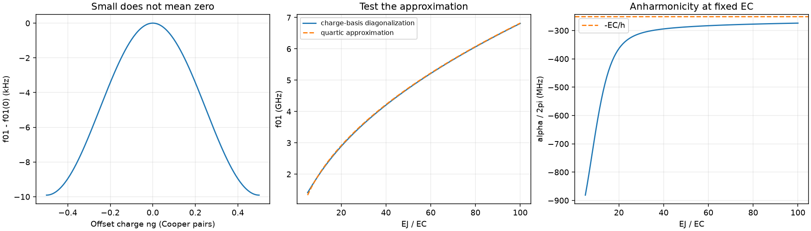

# Charge-basis transmon spectroscopy

Pairs with tutorial chapters 03 to 04; see the [learning path](../../tutorial/learning-path.md) and [notation](../../tutorial/00-notation.md).

## What you simulate

The isolated Cooper-pair box and the transmon share one Hamiltonian,

$$H = 4E_C(\hat n-n_g)^2 - E_J\cos\hat\varphi .$$

In the basis of Cooper-pair number states $|n\rangle$ the charging term is
diagonal, $4E_C(n-n_g)^2$, and $\cos\hat\varphi=\tfrac12\sum_n(|n\rangle\langle n+1|+|n+1\rangle\langle n|)$
hops one Cooper pair at a time, so every off-diagonal element is $-E_J/2$. The
matrix is tridiagonal, and a modest cutoff ($|n|\le20$) already gives the low
levels to machine precision deep in the transmon regime. This lab builds that
matrix, diagonalizes it, and uses the exact levels to answer three questions
from the chapters:

1. How good are the leading-order formulas $hf_{01}\approx\sqrt{8E_JE_C}-E_C$ and $\alpha\approx-E_C$?
2. How large is the residual charge dispersion, the change of $f_{01}$ as $n_g$ runs over a period?
3. Is the answer converged in the charge cutoff?

## Predict, then run

Before running, estimate $f_{01}$, $\alpha/2\pi$ and the $0\to1$ charge dispersion
for $E_C/h=250$ MHz and $E_J/E_C=50$ from the formulas in Chapter 03.

From the **repository root**, after the [shared setup](../README.md):

```bash
python hands-on/09-transmon-spectrum/transmon.py
```

```bash
python hands-on/run_labs.py 09 --check
```

The first command opens a plot. The second runs without a display and fails if a numerical checkpoint is violated. Both save the figure beside the script.

## The code explained

**One function builds and diagonalizes the matrix.** Energies are divided by
$h$ and expressed in GHz. SciPy's `eigh_tridiagonal` takes the diagonal and the
off-diagonal directly and returns only the four lowest eigenvalues:

```python
n = np.arange(-cutoff, cutoff + 1)            # signed Cooper-pair number
eigh_tridiagonal(4 * ec * (n - ng)**2,         # charging energy on the diagonal
                 np.full(2 * cutoff, -ej / 2), # Josephson hopping off the diagonal
                 select="i", select_range=(0, 3))[0]
```

**Offset-charge sweep and convergence check.** `main()` evaluates the levels on
201 values of $n_g\in[-\tfrac12,\tfrac12]$, repeats the calculation with cutoff 30,
and asserts that the two agree to $10^{-9}$ GHz before anything is plotted.

**Observables.** The transition frequency is `f01 = E1 - E0`, the anharmonicity
is the second difference `E2 - 2*E1 + E0` (that is, $f_{12}-f_{01}$), and the
charge dispersion is the peak-to-peak spread of `f01` over the $n_g$ sweep. The
script also converts $E_C$ to the total capacitance $C_\Sigma=e^2/2E_C$.

**Ratio sweep.** Finally it holds $E_C$ fixed, sweeps $E_J/E_C$ from 5 to 100,
and plots the exact $f_{01}$ and $\alpha$ against the leading-order formulas.

## Expected result

At $E_C/h=250$ MHz and $E_J/E_C=50$, expect $f_{01}=4.73548$ GHz, $\alpha/2\pi=-287.31$ MHz,
a charge dispersion of about 9.908 kHz, and $C_\Sigma\approx77.5$ fF. The leading
estimates 4.75 GHz and $-250$ MHz are approximations, not exact answers: the frequency
is off by 0.3%, the anharmonicity by 13%.



Left: the $0\to1$ frequency moves by only about 10 kHz across a full period of
offset charge, small but not zero. Middle: the quartic formula tracks the exact
$f_{01}$ closely once $E_J/E_C\gtrsim20$. Right: the exact anharmonicity is
systematically larger in magnitude than $E_C/h$ and approaches it only slowly as
$E_J/E_C$ grows.

## Experiment

Change EJ/EC from 50 to 20 and 80 at fixed EC. Compare absolute anharmonicity, relative anharmonicity, and charge dispersion. Increase the cutoff from 20 to 30: physical conclusions should not change.

Record your prediction, changed parameter, numerical result, and physical explanation. Edit one parameter at a time. The script's own `assert` on the default charge dispersion stops it after printing and before plotting when EJ/EC changes; comment it out while experimenting, and restore the defaults before running the full verification suite.

## Model and numerical limits

The basis contains charge states -cutoff through +cutoff. The script checks all plotted offset charges against a larger basis. This is an isolated, static single-mode transmon; it has no drive, no loss, no coupled resonator, and no junction-asymmetry or SQUID physics.
