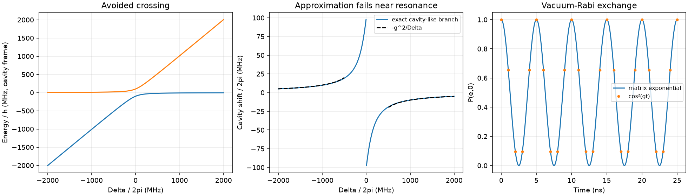

# From vacuum-Rabi exchange to the dispersive limit

Pairs with tutorial chapter 05; see the [learning path](../../tutorial/learning-path.md) and [notation](../../tutorial/00-notation.md).

## What you simulate

The Jaynes-Cummings Hamiltonian conserves the total number of excitations, so
it splits into independent $2\times2$ blocks. The block with one excitation is
spanned by $|e,0\rangle$ (qubit excited, cavity empty) and $|g,1\rangle$ (qubit
in the ground state, one photon). In a frame rotating at the cavity frequency,
and with $\Delta=\omega_q-\omega_r$,

$$\frac{H_1}{\hbar}=\begin{pmatrix}\Delta & g\\ g & 0\end{pmatrix}
\quad\text{in the basis }(|e,0\rangle,\ |g,1\rangle).$$

This one matrix contains both regimes of Chapter 05. On resonance its
eigenvalues are $\pm g$, a splitting of $2g$, and an excitation swaps between
qubit and cavity as $P_{e,0}(t)=\cos^2(gt)$. Far from resonance the cavity-like
eigenvalue is pulled by $-g^2/\Delta$, the two-level dispersive shift. The lab
checks both limits and shows where the perturbative formula stops working.

## Predict, then run

For $g/2\pi=100$ MHz, predict the minimum splitting, the time of a full swap, and
the cavity shift at $\Delta/2\pi=\pm1$ GHz before you run anything.

From the **repository root**, after the [shared setup](../README.md):

```bash
python hands-on/10-jaynes-cummings/jaynes_cummings.py
```

```bash
python hands-on/run_labs.py 10 --check
```

The first command opens a plot. The second runs without a display and fails if a numerical checkpoint is violated. Both save the figure beside the script.

## The code explained

**Units.** Frequencies are angular, in rad/us, so `g = 2*np.pi*100` means
$g/2\pi=100$ MHz and times are in microseconds.

**Spectrum.** For each detuning the script diagonalizes the block with
`np.linalg.eigvalsh([[d, g], [g, 0]])` and checks that the gap at $\Delta=0$ is
exactly $2g$.

**Following the cavity.** Far from resonance one eigenvector is mostly
$|g,1\rangle$. For $\Delta<0$ that is the upper eigenvalue and for $\Delta>0$ the
lower one, so the script picks the branch accordingly and compares it with
$-g^2/\Delta$ wherever $|\Delta|\ge10g$:

```python
cavity_shift = np.where(detunings < 0, energies[:, 1], energies[:, 0])
approx = -g*g/detunings[far]
```

**Dynamics.** Starting from $|e,0\rangle$ at $\Delta=0$, the state is propagated
with an exact matrix exponential, `expm(-1j*hamiltonian*t)`, and the population
is checked against $\cos^2(gt)$ to $10^{-12}$.

## Expected result

For $g/2\pi=100$ MHz, the resonant splitting is 200 MHz and the full excitation swap takes 2.5 ns. At $|\Delta|\ge10g$, the cavity-shift approximation differs from the exact branch by less than 1%.



Left: the two eigenvalues avoid each other with a gap of $2g$. Middle: the
cavity-like branch follows $-g^2/\Delta$ on both wings and departs from it as
$|\Delta|$ approaches $g$; the jump at $\Delta=0$ is where the branch that was
cavity-like changes identity. Right: the vacuum-Rabi oscillation.

## Experiment

Double g and predict the splitting and swap time before running; also widen the detuning sweep well past |Delta| = 10g, or the script's dispersive check only sees the two sweep endpoints. Reduce |Delta|/g and identify where the perturbative cavity shift becomes unreliable.

Record your prediction, changed parameter, numerical result, and physical explanation. Edit one parameter at a time. The automated checks target the documented defaults; restore them before running the full verification suite.

## Model and numerical limits

This is a two-level emitter in the rotating-wave approximation, restricted to the single-excitation manifold and without loss. It demonstrates $-g^2/\Delta$ for the ground-state cavity shift, not the multilevel transmon $\chi=g^2\alpha/[\Delta(\Delta+\alpha)]$; adding the $|f\rangle$ level and the $N=2$ manifold is a good extension. The cavity-like branch changes identity at resonance; its branch-selected plot has a jump there.
