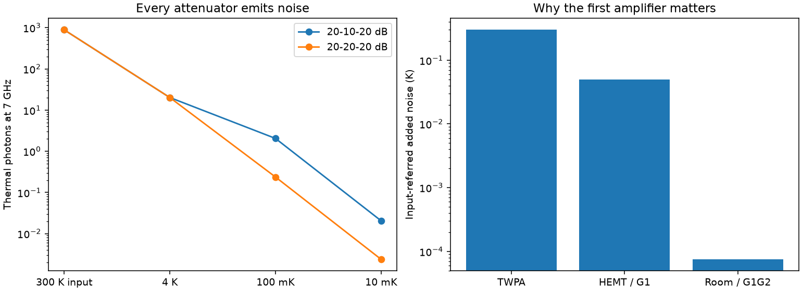

# Thermal photons and amplifier noise

Pairs with tutorial chapter 10; see the [learning path](../../tutorial/learning-path.md) and [notation](../../tutorial/00-notation.md).

## What you simulate

Two bookkeeping rules govern the microwave chain of Chapter 10.

**Input lines.** A matched attenuator with power transmission $1/A$ at
temperature $T$ passes a fraction $1/A$ of the incoming thermal photons and
replaces the rest with its own emission:

$$\bar n_{\rm out}=\frac{\bar n_{\rm in}}{A}+\Big(1-\frac1A\Big)\bar n(\omega,T),\qquad
\bar n(\omega,T)=\frac{1}{e^{\hbar\omega/k_BT}-1}.$$

Applied stage by stage from a 300 K source, this gives the photon occupation
that actually reaches the chip.

**Output lines.** Referred to the input, each amplifier's added noise is divided
by the gain of everything before it (Friis):
$T_{\rm sys}=T_1+T_2/G_1+T_3/(G_1G_2)+\cdots$. The lab evaluates both rules for
the Chapter 10 worked example at 7 GHz.

## Predict, then run

At 7 GHz, $\hbar\omega/k_B=0.336$ K. Predict the occupation after 20 dB at 4 K when
the input comes from room temperature, and decide whether 20/10/20 dB or 20/20/20 dB
reaches $\bar n<0.01$.

From the **repository root**, after the [shared setup](../README.md):

```bash
python hands-on/12-microwave-chain/chain.py
```

```bash
python hands-on/run_labs.py 12 --check
```

The first command opens a plot. The second runs without a display and fails if a numerical checkpoint is violated. Both save the figure beside the script.

## The code explained

**Occupation and cascade.** `occupation(f, T)` is the Bose-Einstein factor in SI
units. `cascade` starts from $\bar n(7\text{ GHz},300\text{ K})\approx892$ and applies
the attenuator rule once per stage:

```python
transmission = 10**(-db/10)
result.append(transmission*result[-1] + (1-transmission)*occupation(f, temperature))
```

**Equilibrium check.** An attenuator fed with photons at its own temperature must
leave the occupation unchanged; the script asserts this identity at 4 K.

**Amplifier budget.** The input-referred contributions of a TWPA (0.3 K), a HEMT
(5 K divided by $G_1=100$) and a room-temperature amplifier (75 K divided by
$G_1G_2=10^6$) are summed, converted to photons with $k_BT/hf$, and turned into a
vacuum-normalized efficiency $\eta_{\rm vac}=\tfrac12/(\tfrac12+n_{\rm add})$.

## Expected result

At 7 GHz, the 20-10-20 dB chain gives $\bar n=0.02055$; the 20-20-20 dB chain gives $\bar n=0.002379$. The amplifier budget is 0.350075 K of added noise, or 1.04 photons, giving $\eta_{\rm vac}=0.324$ (0.648 in the phase-preserving SQL normalization).



Left: occupation after each stage for the two chains; the room-temperature residue
that leaks through the 4 K attenuator keeps the line above the 4 K value, and the
middle attenuator sets the final floor. Right: on a log scale, the TWPA's own noise
dwarfs the HEMT and room-temperature contributions once they are divided by the
preceding gain.

## Experiment

Move the middle attenuator from 100 mK to 4 K without changing total attenuation. Does the same total dB give the same noise? Then lower first-stage amplifier gain from 20 dB to 10 dB and recompute the budget.

Record your prediction, changed parameter, numerical result, and physical explanation. Edit one parameter at a time. The script's own `assert` on the default occupations stops it after printing them and before plotting when the chain changes; comment it out while experimenting, and restore the defaults before running the full verification suite.

## Model and numerical limits

Attenuators are matched and perfectly thermalized. This omits cable loss, amplifier saturation, pump leakage, and actual stage heat loads. Vacuum-normalized efficiency and phase-preserving SQL-normalized efficiency differ by a factor of two; both are printed explicitly.
